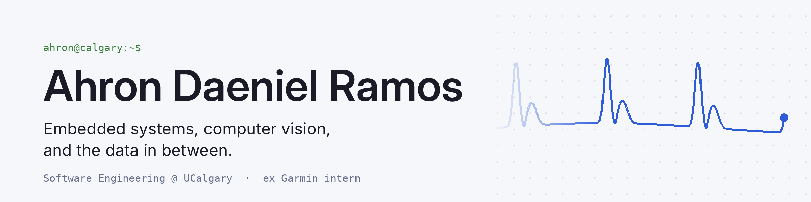

<!-- ───────────── Banner (light/dark) ───────────── -->
<picture>
  <source media="(prefers-color-scheme: dark)" srcset="assets/banner-dark.png">
  
</picture>

<h1>Hey there, I'm Ahron Ramos</h1>

  

 

<!-- ───────────── About ───────────── -->
<h2 align="center">About Me</h2>

<table align="center">
<tr>
<td width="65%" valign="middle">

I'm a software engineering student at the **University of Calgary**. I build small devices that pull signals off sensors, then write the code that figures out what those signals mean. Most days that's C on a microcontroller or Python on the analysis side.

- 🛰️ Spent **16 months** as a software engineering intern at **Garmin Canada**
- 🔬 Building **Hydrosense**, a bioimpedance wearable on an nRF52840 running Zephyr
- 🥈 **2nd place** at Hack the Change 2026 with **PhysioTrace**
- 🧗 Off the keyboard: basketball and rock climbing

</td>
<td width="35%" align="center" valign="middle">

</td>
</tr>
</table>

 

<!-- ───────────── Featured work ───────────── -->
<h2 align="center">Featured Work</h2>

<table align="center">
<tr>
<td width="33%" valign="top" align="center">
<a href="https://github.com/ramos-ahron/hydration-sensor"><b>Hydrosense</b></a> 
nRF52840 · Zephyr · MAX30009 · BLE  
Upper-arm wearable that tracks fluid-status changes against a personal baseline using four-electrode bioimpedance.
</td>
<td width="33%" valign="top" align="center">
<a href="https://github.com/BenTheOOF/hack-the-change-2026-physiotrace"><b>PhysioTrace</b></a> 🥈 
MediaPipe · Next.js · FastAPI · Supabase  
Turns a phone or laptop camera into a rep coach that scores physio exercises in the browser.
</td>
<td width="33%" valign="top" align="center">
<a href="https://github.com/ramos-ahron/Auto-Budget"><b>Auto Budget</b></a> 
React · Spring Boot · MySQL · Docker  
Turns income and expense entries into Gemini-generated spending analysis and emailed reports.
</td>
</tr>
</table>

 

<!-- ───────────── Tech stack ───────────── -->
<h2 align="center">Tech Stack</h2>

<a href="https://skillicons.dev">
  
   
  
</a>

  

 

<!-- ───────────── GitHub stats ───────────── -->
<h2 align="center">GitHub Activity</h2>

<picture>
  <source media="(prefers-color-scheme: dark)" srcset="https://streak-stats.demolab.com?user=ramos-ahron&hide_border=true&background=1A1B26&ring=7AA2F7&fire=F7768E&currStreakLabel=7AA2F7&sideLabels=BB9AF7&currStreakNum=C0CAF5&sideNums=C0CAF5&dates=A9B1D6&stroke=33467C">
  
</picture>

  

<picture>
  <source media="(prefers-color-scheme: dark)" srcset="https://raw.githubusercontent.com/ramos-ahron/ramos-ahron/output/activity-graph-dark.svg">
  
</picture>

 

<!-- ───────────── Contribution snake ───────────── -->
<!--
  The snake is generated by a GitHub Action. Create .github/workflows/snake.yml in this repo:

  name: snake
  on:
    schedule: [{ cron: "0 0 * * *" }]
    workflow_dispatch:
  permissions:
    contents: write
  jobs:
    generate:
      runs-on: ubuntu-latest
      steps:
        - uses: Platane/snk/svg-only@v3
          with:
            github_user_name: ${{ github.repository_owner }}
            outputs: |
              dist/github-snake.svg?color_snake=#2e5bd8&color_dots=#ebedf0,#c7d2fe,#a5b4fc,#7aa2f7,#2e5bd8
              dist/github-snake-dark.svg?palette=github-dark&color_snake=#f7768e&color_dots=#1f2335,#33467c,#5a6fbf,#7aa2f7,#bb9af7
        - uses: crazy-max/ghaction-github-pages@v4
          with:
            target_branch: output
            build_dir: dist
          env:
            GITHUB_TOKEN: ${{ secrets.GITHUB_TOKEN }}

  Then run it once from the Actions tab (Run workflow) so the output branch exists.
-->
<h2 align="center">Contribution Snake</h2>

<picture>
  <source media="(prefers-color-scheme: dark)" srcset="https://raw.githubusercontent.com/ramos-ahron/ramos-ahron/output/github-snake-dark.svg">
  
</picture>

 

<!-- ───────────── Connect ───────────── -->
<h2 align="center">Connect With Me</h2>

<!-- ───────────── Footer ───────────── -->

